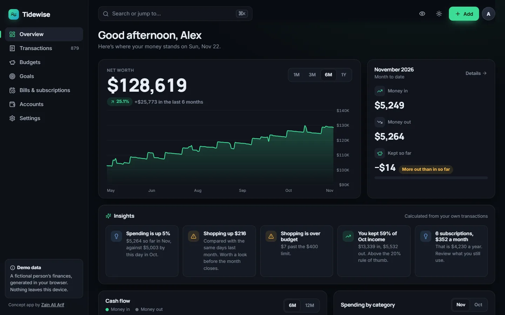

# Tidewise

**Personal finance, calmly handled.** A fast, private money app: net worth, cash flow, budgets with month-end forecasts, savings goals and automatic bill and subscription detection.

Live demo: https://tidewise-finance.vercel.app



> Concept app designed and built by [Zain Ali Arif](https://zainaliarif.com). The demo shows a fictional person's finances, generated in the browser. It is not connected to any bank, and no data leaves the device.

## Features

- **Overview**: animated net worth chart (1M to 1Y), month-to-date income and spending, insights calculated from your own transactions, cash flow by month, spending by category, upcoming bills, budgets to watch and recent activity.
- **Transactions**: search across merchant, note, category and amount; filter by month, category, account and direction; inline recategorizing; multi-select with bulk recategorize and delete; undo for every destructive action.
- **CSV import and export**: reads most bank exports (single amount column, or separate debit and credit columns, US or ISO dates, parentheses for negatives), guesses categories from your history and skips duplicates. Exports are protected against spreadsheet formula injection.
- **Budgets**: monthly limits with a forecast that adds known bills on their due dates and projects variable spending at its current pace, plus a "safe to spend per day" figure and suggestions from your 3-month average.
- **Goals**: progress rings, monthly pace, the amount needed per month for a deadline, and an estimated arrival date.
- **Bills and subscriptions**: detected automatically (same merchant, steady amount, steady schedule), with a monthly calendar and yearly cost.
- **Accounts**: balances derived from transactions, 90-day sparklines and an asset breakdown.
- **Command menu** (Ctrl/⌘ K) and keyboard shortcuts (N new, G then a letter to navigate, T theme, H hide amounts, ? help).
- **Privacy mode** blurs every amount. Light and dark themes, follow the device by default.
- **Installable PWA** that works offline. Data is stored locally, with JSON backup and restore.

## Tech

React 18, TypeScript (strict), Vite, Zustand, React Router. Charts are hand-written SVG (monotone cubic curves, nice-number axes, pointer and keyboard exploration), with no chart library. Money is stored as integer cents. All analytics are pure functions with unit tests (Vitest).

Accessibility: semantic landmarks, skip link, focus-trapped dialogs that restore focus, labelled controls, text errors, screen-reader tables behind charts, and full `prefers-reduced-motion` support.

## Run locally

```bash
npm install
npm run dev      # http://localhost:5173
npm test         # unit tests
npm run build    # type-check and production build
```
